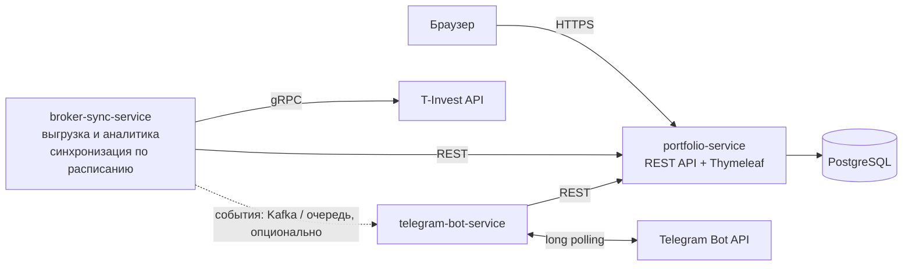

# portfolio-tracker

Учёт инвестиционного портфеля с импортом данных напрямую из API брокера: что, где и по какой цене куплено, сколько съели комиссии, какие были выплаты и какова реальная доходность. Базовый функционал повторяет Snowball Income (учёт акций и облигаций, дивидендная аналитика), но приложение бесплатное и без подписки: отслеживается столько бумаг, сколько есть на счёте, а история операций разбирается полностью — каждая сделка, каждая комиссия, каждая выплата.

## Описание

Пользователь подключает брокерский счёт через T-Invest API (T-Bank; боевой токен или песочница) — это единственный источник данных, другие брокеры пока не поддерживаются. Приложение выгружает все инструменты и всю историю операций счёта, хранит их в своей базе и считает аналитику: позиции, средние цены покупки с учётом комиссий, реализованную и нереализованную прибыль, потери на комиссиях, дивиденды и купоны. Синхронизация идёт по расписанию, уведомления о выплатах приходят в Telegram. Веб-дашборд показывает текущие показатели портфеля — стоимость, P&L, доходность — дивидендный календарь и новости по бумагам.

Чем отличается от Snowball Income: у Snowball больше источников данных — брокерские отчёты (30 брокеров), API Тинькофф с автосинхронизацией дважды в день, Binance, JetLend, ручной ввод сделок, — но отслеживать много бумаг у них можно только по платной подписке. Здесь источник один — T-Invest API (T-Bank): сделки, комиссии и выплаты выгружаются напрямую из API брокера, без загрузки отчётов и без платы за количество бумаг, каждая операция разбирается отдельно.

## Основная функциональность

1. Учёт пользователей: регистрация и вход (Spring Security), токен брокера хранится в базе отдельно от данных пользователя.
2. Управление портфелем (CRUD): подключение брокерского счёта по токену, добавление, изменение и удаление бумаг и сделок вручную — в дополнение к импорту из API.
3. Импорт данных брокера (T-Invest API): счета, инструменты, все операции покупки и продажи, комиссии, дивиденды, купоны, текущие и исторические котировки. Курсорная пагинация — выгрузка идёт до конца истории, без ограничения по количеству бумаг.
4. Аналитика портфеля: по каждой бумаге — сколько куплено, средневзвешенная цена покупки с учётом комиссий, текущая цена, реализованный и нереализованный P&L, сумма уплаченных комиссий, полученные дивиденды и купоны. В целом по портфелю — структура вложений, среднегодовая доходность (XIRR по денежным потокам: пополнения, выводы, выплаты), прибыль с учётом налога на дивиденды, общие потери на комиссиях, дивидендный поток.
5. Веб-дашборд: таблица бумаг, история сделок, разбивка комиссий, дивидендный календарь с прогнозом выплат на год вперёд, график стоимости портфеля, новости по бумагам из портфеля (RSS).
6. Telegram-бот: уведомления о поступивших и ожидаемых выплатах, дайджест портфеля по команде.

## Сквозные улучшения

- Тесты (JUnit 5 + Testcontainers) и CI (GitHub Actions);
- Kafka между broker-sync-service и portfolio-service;
- Наблюдаемость: Actuator, Prometheus, Grafana;
- Контейнеризация всех сервисов и размещение на домене;
- Сравнение доходности с индексами (MOEX, S&P 500);
- Категории активов с целевыми долями (ребалансировка);
- Курсы валют ЦБ для пересчёта портфеля в одну валюту;
- Redis для кеша котировок (опционально).

## Архитектура



Три сервиса в одном Maven-монорепо:

- `portfolio-service` — ядро: REST API, веб-дашборд, единственный владелец базы данных;
- `broker-sync-service` — интеграция с T-Invest API: выгрузка и нормализация данных, расчёт аналитики, расписание синхронизации;
- `telegram-bot-service` — уведомления и команды бота.

Взаимодействие между сервисами: синхронно — REST (`broker-sync-service` и `telegram-bot-service` обращаются к `portfolio-service`) и gRPC к T-Invest API; асинхронно — события обновлений (котировки, новости) через очередь: в docker-compose это Kafka, как минимальный вариант — Spring-события/очередь (см. «Сквозные улучшения»). Потребители событий не знают об их источнике. База данных одна, к ней обращается только `portfolio-service`.

## Технологии

| Технология | Зачем |
| --- | --- |
| Java 25 (LTS) | язык и рантайм; установленный JDK (Corretto 25) |
| Maven, мульти-модульный монорепо | три сервиса в одном репозитории, общие версии зависимостей |
| Spring Boot 4.1 | web, security, jdbc, scheduling без ручной сборки конфигурации; поддерживает Java 25 |
| Spring Web (REST) | API веб-части и связь сервисов между собой |
| Spring Data JDBC + Flyway | доступ к БД: SQL пишется вручную, явные JOIN, без магии Hibernate; миграции версионируемые |
| PostgreSQL 17 | хранение инструментов, операций, комиссий, дивидендов, пользователей |
| Spring Security | регистрация и вход |
| Thymeleaf + Chart.js | веб-дашборд без отдельного фронтенд-проекта (фронт по условиям курса не ограничен, поэтому серверный рендер — самый короткий путь к рабочему виду) |
| T-Invest API (gRPC, Java SDK) | данные брокера: операции, инструменты, котировки; есть песочница для разработки без боевого счёта |
| Resilience4j | retry с backoff, rate limiter, circuit breaker на вызовах API брокера |
| Telegram Bot API (long polling через RestClient) | уведомления без тяжёлых сторонних bot-библиотек |
| Docker Compose | PostgreSQL и сервисы одной командой |
| JUnit 5 + Testcontainers | тесты на настоящей PostgreSQL |
| GitHub Actions | сборка и тесты при каждом push |

## Интересные технические решения

1. Полная выгрузка без лимита бумаг. История операций читается курсорной пагинацией до конца, а не «последние N записей», поэтому количество бумаг и сделок ограничено только историей счёта на стороне брокера.
2. Деньги без потери точности. T-Invest API отдаёт суммы в формате `units + nano`; во всём коде используется `BigDecimal`, `double` не используется нигде. Комиссии (брокерская, биржевая, клиринговая) хранятся отдельными строками по каждой операции.
3. Реальная цена покупки. Средневзвешенная считается как (сумма сделок + комиссии) / количество, поэтому видно, во сколько бумага обошлась на самом деле и сколько съели комиссии.
4. Доходность при нерегулярных пополнениях. Среднегодовая доходность считается как XIRR — численное решение уравнения NPV = 0 по денежным потокам с датами; в JDK готовой функции нет, реализация своя (бисекция).

## Реализация

Фактическое состояние репозитория на текущий момент: реализован backend-каркас — REST API портфелей и позиций поверх PostgreSQL с версионируемыми миграциями Flyway и интеграционными тестами. Сделки (ручные и импортированные), аналитика, веб-дашборд и Telegram-бот пока не реализованы. Реальные данные сделок и финансовые рекомендации в реализованной части отсутствуют.

### Структура репозитория

- `portfolio-service` — Spring Boot приложение: REST API портфелей и позиций, единственный владелец базы данных;
- `pom.xml` — родительский Maven-модуль (Java 25, Spring Boot 4.1.2);
- `docker-compose.yml` — PostgreSQL 17 для локальной разработки.

Модули `broker-sync-service` и `telegram-bot-service` из раздела «Архитектура» будут добавлены позже.

### Модель данных

Миграция `portfolio-service/src/main/resources/db/migration/V1__init.sql`:

| Таблица | Столбцы | Ограничения |
| --- | --- | --- |
| `portfolio` | `id`, `name`, `base_currency`, `created_at` | название непустое и не длиннее 100 символов, валюта — код из трёх заглавных букв |
| `position` | `id`, `portfolio_id`, `ticker`, `instrument_name`, `quantity`, `average_price`, `currency`, `updated_at` | внешний ключ на `portfolio` с каскадным удалением, один тикер на портфель, количество больше нуля, средняя цена неотрицательна, суммы — `NUMERIC(20, 8)` |

### REST API

База — `/api/portfolios`; тело запроса и ответ — JSON.

| Метод и путь | Назначение | Успех | Ошибки |
| --- | --- | --- | --- |
| `POST /api/portfolios` | создать портфель (`name`, `baseCurrency`; валюта по умолчанию `RUB`) | 201 + `Location` | 400 |
| `GET /api/portfolios` | список портфелей | 200 | — |
| `GET /api/portfolios/{id}` | портфель по идентификатору | 200 | 404 |
| `PUT /api/portfolios/{id}` | изменить портфель (`name` обязателен, `baseCurrency` необязателен — без него остаётся прежним) | 200 | 400, 404 |
| `DELETE /api/portfolios/{id}` | удалить портфель вместе с позициями | 204 | 404 |
| `GET /api/portfolios/{id}/positions` | состав портфеля (позиции по алфавиту тикеров) | 200 | 404 |
| `POST /api/portfolios/{id}/positions` | добавить позицию (`ticker`, `quantity`, `averagePrice`; `instrumentName`, `currency` необязательны) | 201 + `Location` | 400, 404, 409 |
| `GET /api/portfolios/{id}/positions/{positionId}` | позиция по идентификатору | 200 | 404 |
| `PUT /api/portfolios/{id}/positions/{positionId}` | изменить позицию (`quantity`, `averagePrice` обязательны; `instrumentName`, `currency` без значения не изменяются; тикер неизменяем) | 200 | 400, 404 |
| `DELETE /api/portfolios/{id}/positions/{positionId}` | удалить позицию | 204 | 404 |

### Валидация и ошибки

Валидация на уровне приложения и дублируется ограничениями БД: название портфеля — непустая строка до 100 символов; валюты — код ISO 4217 из трёх заглавных букв; тикер — до 32 символов (заглавные буквы, цифры, точка, дефис, подчёркивание); количество — больше нуля, средняя цена — неотрицательна; суммы — не более 12 цифр до запятой и 8 после.

Ответ об ошибке — единый формат:

```json
{
  "timestamp": "2026-11-10T16:06:18.1734016+03:00",
  "status": 400,
  "error": "Bad Request",
  "message": "Запрос не прошёл валидацию",
  "path": "/api/portfolios",
  "fieldErrors": [
    {"field": "name", "message": "название портфеля не может быть пустым"}
  ]
}
```

404 — сущность не найдена, 409 — тикер уже есть в портфеле.

### Запуск и тесты

1. Поднять PostgreSQL: `docker compose up -d` (база `portfolio_db`, пользователь и пароль `portfolio`, порт 5432).
2. Запустить приложение: `mvn spring-boot:run` из каталога `portfolio-service` либо класс `PortfolioTrackerApplication` в IDEA. Миграции Flyway применяются при старте автоматически.
3. Проверить API: `GET http://localhost:8080/api/portfolios`.

Тесты: `mvn test` из корня репозитория — интеграционные тесты REST API запускаются на настоящей PostgreSQL в Docker (Testcontainers), покрывают создание портфеля, добавление, изменение и удаление позиций, получение состава, валидацию и коды ошибок. Docker должен быть запущен.

## План работ

1. Каркас: Maven-монорепо, docker-compose с PostgreSQL, Flyway-схема (пользователи, инструменты, операции, комиссии, выплаты, позиции).
2. БД и домен: доменные сущности, Spring Data JDBC-репозитории, правила расчёта средних цен и P&L.
3. Интеграция с брокером: клиент T-Invest API (песочница), выгрузка счетов, инструментов, операций и котировок, идемпотентные апсерты, расписание синхронизации.
4. Telegram-бот: уведомления о поступивших и ожидаемых выплатах, дайджест портфеля.
5. Веб: REST API и дашборд (бумаги, сделки, комиссии, дивидендный календарь, график стоимости, новости).
6. Тесты и CI: JUnit 5 + Testcontainers на настоящей PostgreSQL, GitHub Actions — сборка и тесты при каждом push.

Сквозные улучшения подключаются поверх ядра в любом порядке.
