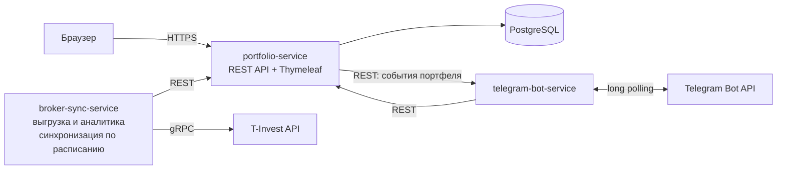

# portfolio-tracker

Учёт инвестиционного портфеля с импортом данных напрямую из API брокера: что, где и по какой цене куплено, сколько съели комиссии, какие были выплаты и какова реальная доходность. Базовый функционал повторяет Snowball Income (учёт акций и облигаций, дивидендная аналитика), но приложение бесплатное и без подписки: отслеживается столько бумаг, сколько есть на счёте, а история операций разбирается полностью — каждая сделка, каждая комиссия, каждая выплата.

## Описание

Пользователь подключает брокерский счёт через T-Invest API (T-Bank; боевой токен или песочница) — это единственный источник данных, другие брокеры пока не поддерживаются. Приложение выгружает все инструменты и всю историю операций счёта, хранит их в своей базе и считает аналитику: позиции, средние цены покупки с учётом комиссий, реализованную и нереализованную прибыль, потери на комиссиях, дивиденды и купоны. Синхронизация идёт по расписанию, уведомления о выплатах приходят в Telegram. Веб-дашборд показывает текущие показатели портфеля — стоимость, P&L, доходность — дивидендный календарь и новости по бумагам.

Чем отличается от Snowball Income: у Snowball больше источников данных — брокерские отчёты (30 брокеров), API Тинькофф с автосинхронизацией дважды в день, Binance, JetLend, ручной ввод сделок, — но отслеживать много бумаг у них можно только по платной подписке. Здесь источник один — T-Invest API (T-Bank): сделки, комиссии и выплаты выгружаются напрямую из API брокера, без загрузки отчётов и без платы за количество бумаг, каждая операция разбирается отдельно.

## Основная функциональность

1. Учёт пользователей: регистрация и вход (Spring Security), токен брокера хранится в базе отдельно от данных пользователя.
2. Управление портфелем (CRUD): подключение брокерского счёта по токену, добавление, изменение и удаление бумаг и сделок вручную — в дополнение к импорту из API.
3. Импорт данных брокера (T-Invest API): счета, инструменты, все операции покупки и продажи, комиссии, дивиденды, купоны, текущие и исторические котировки. Курсорная пагинация — выгрузка идёт до конца истории, без ограничения по количеству бумаг.
4. Аналитика портфеля: по каждой бумаге — сколько куплено, средневзвешенная цена покупки с учётом комиссий, текущая цена, реализованный и нереализованный P&L, сумма уплаченных комиссий, полученные дивиденды и купоны. В целом по портфелю — структура вложений, среднегодовая доходность (XIRR по денежным потокам: пополнения, выводы, выплаты), прибыль с учётом налога на дивиденды, общие потери на комиссиях, дивидендный поток.
5. Веб-дашборд: таблица бумаг, история сделок, разбивка комиссий, дивидендный календарь с прогнозом выплат на год вперёд, график стоимости портфеля, новости по бумагам из портфеля (RSS).
6. Telegram-бот: уведомления о поступивших и ожидаемых выплатах, дайджест портфеля по команде.

## Сквозные улучшения

- Тесты (JUnit 5 + Testcontainers) и CI (GitHub Actions);
- Kafka между broker-sync-service и portfolio-service;
- Наблюдаемость: Actuator, Prometheus, Grafana;
- Контейнеризация всех сервисов и размещение на домене;
- Сравнение доходности с индексами (MOEX, S&P 500);
- Категории активов с целевыми долями (ребалансировка);
- Курсы валют ЦБ для пересчёта портфеля в одну валюту;
- Redis для кеша котировок (опционально).

## Архитектура



Три сервиса в одном Maven-монорепо:

- `portfolio-service` — ядро: REST API, веб-дашборд, единственный владелец базы данных;
- `broker-sync-service` — интеграция с T-Invest API: выгрузка и нормализация данных, расчёт аналитики, расписание синхронизации;
- `telegram-bot-service` — уведомления и команды бота.

Взаимодействие между сервисами: синхронно — REST (`broker-sync-service` и `telegram-bot-service` обращаются к `portfolio-service`, а `portfolio-service` шлёт события портфеля в `telegram-bot-service`) и gRPC к T-Invest API; асинхронно — события обновлений (котировки, новости) через очередь: в docker-compose это Kafka, как минимальный вариант — Spring-события/очередь (см. «Сквозные улучшения»). Потребители событий не знают об их источнике. База данных одна, к ней обращается только `portfolio-service`.

## Технологии

| Технология | Зачем |
| --- | --- |
| Java 25 (LTS) | язык и рантайм; установленный JDK (Corretto 25) |
| Maven, мульти-модульный монорепо | три сервиса в одном репозитории, общие версии зависимостей |
| Spring Boot 4.1 | web, security, jdbc, scheduling без ручной сборки конфигурации; поддерживает Java 25 |
| Spring Web (REST) | API веб-части и связь сервисов между собой |
| Spring Data JDBC + Flyway | доступ к БД: SQL пишется вручную, явные JOIN, без магии Hibernate; миграции версионируемые |
| PostgreSQL 17 | хранение инструментов, операций, комиссий, дивидендов, пользователей |
| Spring Security | регистрация и вход |
| Thymeleaf + Chart.js | веб-дашборд без отдельного фронтенд-проекта (фронт по условиям курса не ограничен, поэтому серверный рендер — самый короткий путь к рабочему виду) |
| T-Invest API (gRPC, Java SDK) | данные брокера: операции, инструменты, котировки; есть песочница для разработки без боевого счёта |
| Resilience4j | retry с backoff, rate limiter, circuit breaker на вызовах API брокера |
| Telegram Bot API (long polling через RestClient) | уведомления без тяжёлых сторонних bot-библиотек |
| Docker Compose | PostgreSQL и сервисы одной командой |
| JUnit 5 + Testcontainers | тесты на настоящей PostgreSQL |
| GitHub Actions | сборка и тесты при каждом push |

## Интересные технические решения

1. Полная выгрузка без лимита бумаг. История операций читается курсорной пагинацией до конца, а не «последние N записей», поэтому количество бумаг и сделок ограничено только историей счёта на стороне брокера.
2. Деньги без потери точности. T-Invest API отдаёт суммы в формате `units + nano`; во всём коде используется `BigDecimal`, `double` не используется нигде. Комиссии (брокерская, биржевая, клиринговая) хранятся отдельными строками по каждой операции.
3. Реальная цена покупки. Средневзвешенная считается как (сумма сделок + комиссии) / количество, поэтому видно, во сколько бумага обошлась на самом деле и сколько съели комиссии.
4. Доходность при нерегулярных пополнениях. Среднегодовая доходность считается как XIRR — численное решение уравнения NPV = 0 по денежным потокам с датами; в JDK готовой функции нет, реализация своя (бисекция).

## Реализация

Фактическое состояние репозитория на текущий момент: реализован backend-каркас — REST API портфелей и позиций поверх PostgreSQL с версионируемыми миграциями Flyway и интеграционными тестами — веб-интерфейс для просмотра портфелей и позиций, их добавления и изменения, а также сервис уведомлений с Telegram-ботом (`telegram-bot-service`). Сделки (ручные и импортированные), аналитика с котировками и полноценный дашборд пока не реализованы. Реальные данные сделок и финансовые рекомендации в реализованной части отсутствуют.

### Структура репозитория

- `portfolio-service` — Spring Boot приложение: REST API портфелей и позиций, веб-интерфейс (`src/main/resources/templates` — Thymeleaf-страница, `src/main/resources/static` — `app.js`, `styles.css`), единственный владелец базы данных;
- `telegram-bot-service` — Spring Boot приложение (порт 8082): приём событий портфеля, подписки чатов, команды бота и отправка сообщений через Telegram Bot API;
- `pom.xml` — родительский Maven-модуль (Java 25, Spring Boot 4.1.2);
- `docker-compose.yml` — PostgreSQL 17 для локальной разработки.

Модуль `broker-sync-service` из раздела «Архитектура» будет добавлен позже.

### Модель данных

Миграция `portfolio-service/src/main/resources/db/migration/V1__init.sql`:

| Таблица | Столбцы | Ограничения |
| --- | --- | --- |
| `portfolio` | `id`, `name`, `base_currency`, `created_at` | название непустое и не длиннее 100 символов, валюта — код из трёх заглавных букв |
| `position` | `id`, `portfolio_id`, `ticker`, `instrument_name`, `quantity`, `average_price`, `currency`, `updated_at` | внешний ключ на `portfolio` с каскадным удалением, один тикер на портфель, количество больше нуля, средняя цена неотрицательна, суммы — `NUMERIC(20, 8)` |

### REST API

База — `/api/portfolios`; тело запроса и ответ — JSON.

| Метод и путь | Назначение | Успех | Ошибки |
| --- | --- | --- | --- |
| `POST /api/portfolios` | создать портфель (`name`, `baseCurrency`; валюта по умолчанию `RUB`) | 201 + `Location` | 400 |
| `GET /api/portfolios` | список портфелей | 200 | — |
| `GET /api/portfolios/{id}` | портфель по идентификатору | 200 | 404 |
| `PUT /api/portfolios/{id}` | изменить портфель (`name` обязателен, `baseCurrency` необязателен — без него остаётся прежним) | 200 | 400, 404 |
| `DELETE /api/portfolios/{id}` | удалить портфель вместе с позициями | 204 | 404 |
| `GET /api/portfolios/{id}/positions` | состав портфеля (позиции по алфавиту тикеров) | 200 | 404 |
| `POST /api/portfolios/{id}/positions` | добавить позицию (`ticker`, `quantity`, `averagePrice`; `instrumentName`, `currency` необязательны) | 201 + `Location` | 400, 404, 409 |
| `GET /api/portfolios/{id}/positions/{positionId}` | позиция по идентификатору | 200 | 404 |
| `PUT /api/portfolios/{id}/positions/{positionId}` | изменить позицию (`quantity`, `averagePrice` обязательны; `instrumentName`, `currency` без значения не изменяются; тикер неизменяем) | 200 | 400, 404 |
| `DELETE /api/portfolios/{id}/positions/{positionId}` | удалить позицию | 204 | 404 |

### Валидация и ошибки

Валидация на уровне приложения и дублируется ограничениями БД: название портфеля — непустая строка до 100 символов; валюты — код ISO 4217 из трёх заглавных букв; тикер — до 32 символов (заглавные буквы, цифры, точка, дефис, подчёркивание); количество — больше нуля, средняя цена — неотрицательна; суммы — не более 12 цифр до запятой и 8 после.

Ответ об ошибке — единый формат:

```json
{
  "timestamp": "2026-11-10T16:06:18.1734016+03:00",
  "status": 400,
  "error": "Bad Request",
  "message": "Запрос не прошёл валидацию",
  "path": "/api/portfolios",
  "fieldErrors": [
    {"field": "name", "message": "название портфеля не может быть пустым"}
  ]
}
```

404 — сущность не найдена, 409 — тикер уже есть в портфеле.

### Веб-интерфейс

Основной веб-фронтенд — отдельный React-проект в каталоге `frontend/` (экраны входа, дашборд, сделки, страница бумаги, дивидендный календарь, настройки); запуск описан в разделе «Как запустить фронтенд».

Ниже — оставшаяся встроенная страница из `portfolio-service`: Thymeleaf + обычный JavaScript без сборщика, как и записано в разделе «Технологии»: отдельного backend-проекта под неё не заводится, страница отдаётся из `portfolio-service`. Страница (`templates/dashboard.html`) загружается с сервера, а данные запрашиваются у того же backend по REST (`app.js`, `fetch` к `/api/portfolios`), поэтому отдельной настройки CORS не нужно.

Что можно сделать на странице:

- посмотреть список портфелей и открыть любой из них;
- создать портфель, переименовать его, удалить вместе с позициями;
- посмотреть состав портфеля: тикер, название, количество, средняя цена, валюта, стоимость, доля позиции;
- добавить позицию, изменить количество, среднюю цену, название и валюту (тикер при изменении не меняется), удалить позицию;
- увидеть показатели портфеля: количество позиций и вложенную сумму по каждой валюте (количество × средняя цена, доли считаются в пределах валюты позиции).

Показатели считаются только из данных, пришедших из API: рыночные котировки не подключены, поэтому текущая стоимость по рынку, P&L и доходность не отображаются, а не подменяются выдуманными значениями.

Состояния интерфейса: пока идёт запрос, показывается индикатор загрузки и кнопки недоступны; ошибки выводятся сообщением сервера в едином формате `ApiError` — общий баннер для сбоев связи и операций со списками, ошибки формы — внутри диалога вместе с указанием полей (например, 409 при дубликате тикера). Если backend недоступен, баннер сообщает об этом, и запрос повторяется после обновления страницы.

### Сервис уведомлений и Telegram-бот

Модуль `telegram-bot-service` — отдельное Spring Boot-приложение (порт 8082) с собственной маленькой БД (H2-файл): бот хранит только связь chat id ↔ user id, JWT пользователя и журнал отправленных напоминаний; бизнес-данные портфеля всегда читает из `portfolio-service` по REST.

**Привязка чата.** Пользователь получает одноразовый код в веб-приложении (Настройки → «Привязать Telegram», `POST /api/settings/telegram/link-code`; код живёт 15 минут) и отправляет боту `/start <код>`. Бот обменивает код на долгоживущий JWT через `POST /api/telegram/link` (маршрут открыт без токена, секретность — сам код; он одноразовый, повторное использование даёт `401`). После привязки бот работает от имени пользователя: команды и уведомления используют его токен и его настройки.

**Команды бота:**

| Команда | Действие |
| --- | --- |
| `/start <код>` | привязка чата к аккаунту по одноразовому коду |
| `/portfolio` | сводка: общая стоимость, P&L, крупнейшие позиции (метрики всех портфелей) |
| `/dividends` | ближайшие дивидендные выплаты (дивидендный календарь портфелей) |
| `/alerts on\|off` | включение/выключение уведомлений |
| `/unlink` | отвязка чата |
| `/help` | подсказка |

**Уведомления** (идут только привязанным чатам с включёнными `/alerts`):

- *изменение цены* — `market-data-service` шлёт REST-вебхук `POST /api/events/price` (`PRICE_CHANGED`); бот сравнивает изменение с порогом пользователя (настраивается в веб-приложении, по умолчанию 5%) и отправляет алерт, только если бумага есть в портфеле пользователя;
- *предстоящие дивиденды* — раз в час бот проверяет дивидендные календарии портфелей (данные `market-data-service` через `portfolio-service`) и за 3 дня до выплаты шлёт напоминание; каждое напоминание отправляется один раз (журнал в БД бота);
- *события портфеля* — `portfolio-service` шлёт `POST /api/events` (создан/удалён портфель, добавлена/изменена/удалена позиция).

**Способ связи с backend — REST в обе стороны:**

| Направление | Вызов | Зачем |
| --- | --- | --- |
| `telegram-bot-service` → `portfolio-service` | `POST /api/telegram/link`, `GET /api/portfolios`, `GET /api/portfolios/{id}/metrics`, `GET /api/portfolios/{id}/dividend-calendar`, `GET /api/settings` | привязка по коду, команды `/portfolio` и `/dividends`, порог алерта |
| `portfolio-service` → `telegram-bot-service` | `POST /api/events` | события портфеля |
| `market-data-service` → `telegram-bot-service` | `POST /api/events/price` | изменения цен (`PRICE_CHANGED`) |

REST выбран вместо очереди, потому что в первой версии это единственный потребитель событий и один-два события за операцию: синхронный вызов проще в запуске и отладке, а контракт события не меняется при последующем переходе на Kafka (см. «Сквозные улучшения») — достаточно перенести отправку на очередь, формат события останется тем же.

Контракт события портфеля — JSON:

```json
{
  "eventType": "POSITION_CREATED",
  "portfolioId": 1,
  "positionId": 5,
  "ticker": "SBER",
  "quantity": 10,
  "averagePrice": 310.5,
  "currency": "RUB",
  "occurredAt": "2026-11-10T18:00:00+03:00"
}
```

`eventType` — одно из `PORTFOLIO_CREATED`, `PORTFOLIO_DELETED`, `POSITION_CREATED`, `POSITION_UPDATED`, `POSITION_DELETED`; поля позиции заполнены только для `POSITION_*`. Контракт изменения цены (`POST /api/events/price`) повторяет payload `market-data-service`: `event=PRICE_CHANGED`, `ticker`, `previousPrice`, `newPrice`, `changePercent`, `currency`, `quotedAt`, `source`. Ответ обоих маршрутов — `202` с числом доставленных чатов (`{"delivered":1}`), `400` при ошибке валидации в том же формате `ApiError`, что и в `portfolio-service`.

Отправка событий из `portfolio-service` выключена, пока не задан `NOTIFICATIONS_WEBHOOK_URL` (например, `http://localhost:8082/api/events`), а из `market-data-service` — пока не задан `MARKET_DATA_WEBHOOK_URL` (например, `http://localhost:8082/api/events/price`): без них вызовы — no-op и существующие сценарии API работают без сервиса уведомлений. Сбой вебхука логируется и не прерывает операцию с портфелем/котировками.

**Отказоустойчивость.** Если `portfolio-service` недоступен, бот отвечает вежливым сообщением («Сервис портфелей временно недоступен, попробуйте позже»), а уведомления пропускаются с записью в лог; отправка сообщений в Telegram повторяется до 3 раз с нарастающей паузой. Если токен пользователя отклонён (истёк), бот просит привязать чат заново.

**Безопасность и секреты.** Секреты — токен Telegram-бота, JWT-секрет и токен T-Invest:

- все секреты задаются только переменными окружения (см. `.env.example`); в репозитории и в `application.yaml` их нет, `.env` в `.gitignore`;
- без `TELEGRAM_BOT_TOKEN` сервис запускается и работает: приём событий и команды функционируют, но сообщения не отправляются — шлюз пишет в лог, что токен не задан, и не делает запросов к Telegram; long polling при этом выключен;
- токен выдаётся в [@BotFather](https://t.me/BotFather) при создании бота; при утечке токена его нужно отозвать через `/revoke` там же и задать новый в окружении;
- в логи не попадают ни URL запросов к Bot API (в них входит токен), ни тексты ошибок с телом запроса.

**Локальный запуск:**

1. Поднять PostgreSQL и `portfolio-service` (см. «Запуск и тесты»).
2. Запустить сервис уведомлений: `mvn spring-boot:run` из каталога `telegram-bot-service` либо класс `TelegramBotApplication` в IDEA. Порт — 8082.
3. (Необязательно) Задать токен и вебхуки, чтобы бот реально отправлял сообщения и получал события:
   - PowerShell: `$env:TELEGRAM_BOT_TOKEN="токен_из_BotFather"`; bash: `export TELEGRAM_BOT_TOKEN=...`;
   - `portfolio-service`: `$env:NOTIFICATIONS_WEBHOOK_URL="http://localhost:8082/api/events"` до запуска;
   - `market-data-service`: `$env:MARKET_DATA_WEBHOOK_URL="http://localhost:8082/api/events/price"` до запуска.
4. Привязать чат: в веб-приложении получить код (Настройки → «Привязать Telegram»), отправить боту `/start <код>`.
5. Проверить без Telegram: `POST http://localhost:8082/api/events` с телом события из примера выше — ответ `202` и запись в лог о доставке (или о пропуске, если привязанных чатов нет).

Тесты сервиса уведомлений входят в общий `mvn test` из корня репозитория и не обращаются к Telegram: сценарий «привязка → событие → сообщение» проверяется на записывающем шлюзе (`RecordingTelegramGateway`) и заглушке `portfolio-service`, запросы к Bot API — на `MockRestServiceServer`, команды бота — на заглушке `portfolio-service`.

### Запуск и тесты

1. Поднять PostgreSQL: `docker compose up -d` (база `portfolio_db`, пользователь и пароль `portfolio`, порт 5432).
2. Запустить приложение: `mvn spring-boot:run` из каталога `portfolio-service` либо класс `PortfolioTrackerApplication` в IDEA. Миграции Flyway применяются при старте автоматически.
3. Открыть веб-интерфейс: `http://localhost:8080/`. API проверяется тем же адресом: `GET http://localhost:8080/api/portfolios`.

Тесты: `mvn test` из корня репозитория — интеграционные тесты REST API и веб-страницы запускаются на настоящей PostgreSQL в Docker (Testcontainers), покрывают создание портфеля, добавление, изменение и удаление позиций, получение состава, валидацию, коды ошибок и отдачу страницы с ресурсами; сервис уведомлений тестируется без обращения к Telegram. Docker должен быть запущен.

## Как запустить фронтенд

Веб-фронтенд — отдельный React-проект в каталоге `frontend/` (TypeScript, Vite, Recharts): вход и регистрация с обработкой ошибок, дашборд портфеля с показателями и графиком стоимости, управление сделками с поиском бумаг по тикеру, страница бумаги (котировка, история, дивиденды, новости), дивидендный календарь и настройки (код привязки Telegram-бота, порог алертов). Данные — только через REST: nginx внутри контейнера проксирует `/api` на `portfolio-service`, а `/market` — на `market-data-service`, поэтому CORS не настраивается.

### Полный стек одной командой

Нужен Docker с запущенным демоном:

```bash
docker compose up --build
```

Поднимаются PostgreSQL (5432), adminer (http://localhost:8083), market-data-service (8081), portfolio-service (8080), telegram-bot-service (8082) и frontend — **http://localhost:8084**. Миграции Flyway применяются сервисами при старте (включая настройки пользователей в `V3__user_settings.sql`). Первый сбор образов занимает несколько минут (Maven внутри контейнера), последующие сборки используют кэш слоёв.

Необязательные секреты задаются через `.env` в корне репозитория: `JWT_SECRET` (подпись токенов), `T_INVEST_TOKEN` (котировки Т-Банка вместо MOEX ISS), `TELEGRAM_BOT_TOKEN` (реальная отправка сообщений). Без них приложение работает в демо-режиме: котировки берутся с MOEX ISS, отправка в Telegram отключена.

### Режим разработки

1. Поднять базу и backend: `docker compose up -d postgres`, затем `portfolio-service` на 8080 и `market-data-service` на 8081 (см. «Запуск и тесты»).
2. В каталоге `frontend/` выполнить `npm install`, затем `npm run dev` — Vite поднимет http://localhost:5173 и проксирует `/api` → `localhost:8080`, `/market` → `localhost:8081`.
3. Продакшен-сборка: `npm run build` — проверка типов (`tsc`) и сборка `vite build`, результат в `frontend/dist/`; в Docker этим занимается `frontend/Dockerfile`.

Регистрация выпускает JWT-токен, он хранится в localStorage и подставляется в заголовок `Authorization: Bearer`; при ответе 401 приложение очищает токен и возвращает на экран входа.

## План работ

1. Каркас: Maven-монорепо, docker-compose с PostgreSQL, Flyway-схема (пользователи, инструменты, операции, комиссии, выплаты, позиции).
2. БД и домен: доменные сущности, Spring Data JDBC-репозитории, правила расчёта средних цен и P&L.
3. Интеграция с брокером: клиент T-Invest API (песочница), выгрузка счетов, инструментов, операций и котировок, идемпотентные апсерты, расписание синхронизации.
4. Telegram-бот: уведомления о поступивших и ожидаемых выплатах, дайджест портфеля.
5. Веб: REST API и дашборд (бумаги, сделки, комиссии, дивидендный календарь, график стоимости, новости).
6. Тесты и CI: JUnit 5 + Testcontainers на настоящей PostgreSQL, GitHub Actions — сборка и тесты при каждом push.

Сквозные улучшения подключаются поверх ядра в любом порядке.
