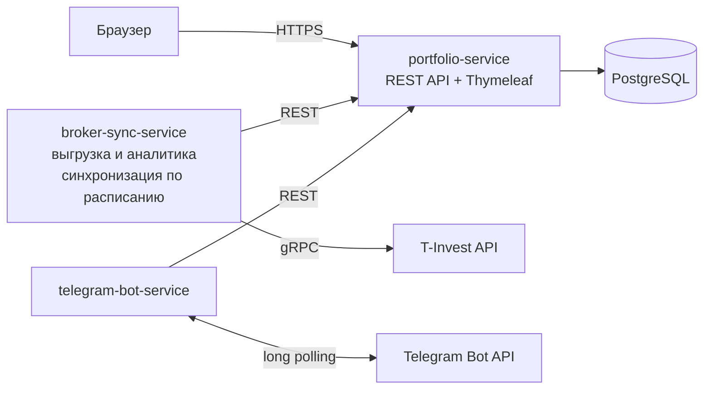

# portfolio-tracker

Учёт инвестиционного портфеля с импортом данных напрямую из API брокера: что, где и по какой цене куплено, сколько съели комиссии, какие были выплаты и какова реальная доходность. Базовый функционал повторяет Snowball Income (учёт акций и облигаций, дивидендная аналитика), но приложение бесплатное и без подписки: отслеживается столько бумаг, сколько есть на счёте, а история операций разбирается полностью — каждая сделка, каждая комиссия, каждая выплата.

## Описание

Пользователь подключает брокерский счёт через T-Invest API (T-Bank; боевой токен или песочница) — это единственный источник данных, другие брокеры пока не поддерживаются. Приложение выгружает все инструменты и всю историю операций счёта, хранит их в своей базе и считает аналитику: позиции, средние цены покупки с учётом комиссий, реализованную и нереализованную прибыль, потери на комиссиях, дивиденды и купоны. Синхронизация идёт по расписанию, уведомления о выплатах приходят в Telegram.

Чем отличается от Snowball Income: у Snowball больше источников данных — брокерские отчёты (30 брокеров), API Тинькофф с автосинхронизацией дважды в день, Binance, JetLend, ручной ввод сделок, — но отслеживать много бумаг у них можно только по платной подписке. Здесь источник один — T-Invest API (T-Bank): сделки, комиссии и выплаты выгружаются напрямую из API брокера, без загрузки отчётов и без платы за количество бумаг, каждая операция разбирается отдельно.

## Основная функциональность

1. Импорт данных брокера (T-Invest API): счета, инструменты, все операции покупки и продажи, комиссии, дивиденды, купоны, котировки. Курсорная пагинация — выгрузка идёт до конца истории, без ограничения по количеству бумаг.
2. Аналитика портфеля: по каждой бумаге — сколько куплено, средневзвешенная цена покупки с учётом комиссий, текущая цена, реализованный и нереализованный P&L, сумма уплаченных комиссий, полученные дивиденды и купоны. В целом по портфелю — структура вложений, среднегодовая доходность (XIRR по денежным потокам: пополнения, выводы, выплаты), прибыль с учётом налога на дивиденды, общие потери на комиссиях, дивидендный поток.
3. Веб-дашборд: таблица бумаг, история сделок, разбивка комиссий, дивидендный календарь с прогнозом выплат на год вперёд, график стоимости портфеля.
4. Telegram-бот: уведомления о поступивших и ожидаемых выплатах, дайджест портфеля по команде.
5. Учёт пользователей: регистрация и вход (Spring Security), токен брокера хранится в базе отдельно от данных пользователя.

## Сквозные улучшения

- Тесты (JUnit 5 + Testcontainers) и CI (GitHub Actions);
- Kafka между broker-sync-service и portfolio-service;
- Наблюдаемость: Actuator, Prometheus, Grafana;
- Контейнеризация всех сервисов и размещение на домене;
- Новости по бумагам из портфеля (парсинг RSS);
- Сравнение доходности с индексами (MOEX, S&P 500);
- Категории активов с целевыми долями (ребалансировка);
- Курсы валют ЦБ для пересчёта портфеля в одну валюту.

## Архитектура

Три сервиса в одном Maven-монорепо:

- `portfolio-service` — ядро: REST API, веб-дашборд, единственный владелец базы данных;
- `broker-sync-service` — интеграция с T-Invest API: выгрузка и нормализация данных, расчёт аналитики, расписание синхронизации;
- `telegram-bot-service` — уведомления и команды бота.

Взаимодействие между сервисами: `broker-sync-service` и `telegram-bot-service` обращаются к `portfolio-service` по REST. База данных одна, к ней обращается только `portfolio-service`.

## Технологии

| Технология | Зачем |
| --- | --- |
| Java 25 (LTS) | язык и рантайм; установленный JDK (Corretto 25) |
| Maven, мульти-модульный монорепо | три сервиса в одном репозитории, общие версии зависимостей |
| Spring Boot 4.1 | web, security, jdbc, scheduling без ручной сборки конфигурации; поддерживает Java 25 |
| Spring Web (REST) | API веб-части и связь сервисов между собой |
| Spring Data JDBC + Flyway | доступ к БД: SQL пишется вручную, явные JOIN, без магии Hibernate; миграции версионируемые |
| PostgreSQL 17 | хранение инструментов, операций, комиссий, дивидендов, пользователей |
| Spring Security | регистрация и вход |
| Thymeleaf + Chart.js | веб-дашборд без отдельного фронтенд-проекта (фронт по условиям курса не ограничен, поэтому серверный рендер — самый короткий путь к рабочему виду) |
| T-Invest API (gRPC, Java SDK) | данные брокера: операции, инструменты, котировки; есть песочница для разработки без боевого счёта |
| Resilience4j | retry с backoff, rate limiter, circuit breaker на вызовах API брокера |
| Telegram Bot API (long polling через RestClient) | уведомления без тяжёлых сторонних bot-библиотек |
| Docker Compose | PostgreSQL и сервисы одной командой |
| JUnit 5 + Testcontainers | тесты на настоящей PostgreSQL |
| GitHub Actions | сборка и тесты при каждом push |

## Интересные технические решения

1. Полная выгрузка без лимита бумаг. История операций читается курсорной пагинацией до конца, а не «последние N записей», поэтому количество бумаг и сделок ограничено только историей счёта на стороне брокера.
2. Деньги без потери точности. T-Invest API отдаёт суммы в формате `units + nano`; во всём коде используется `BigDecimal`, `double` не используется нигде. Комиссии (брокерская, биржевая, клиринговая) хранятся отдельными строками по каждой операции.
3. Реальная цена покупки. Средневзвешенная считается как (сумма сделок + комиссии) / количество, поэтому видно, во сколько бумага обошлась на самом деле и сколько съели комиссии.
4. Доходность при нерегулярных пополнениях. Среднегодовая доходность считается как XIRR — численное решение уравнения NPV = 0 по денежным потокам с датами; в JDK готовой функции нет, реализация своя (бисекция).
